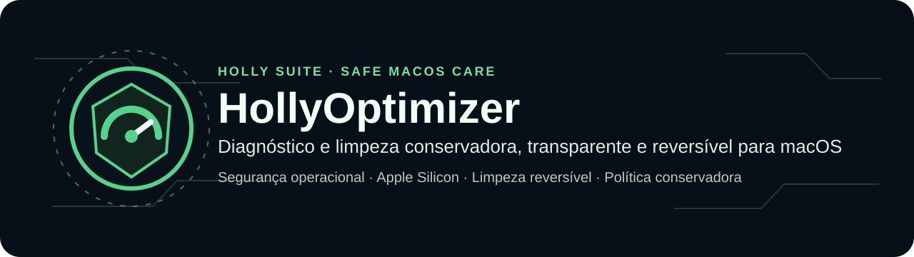
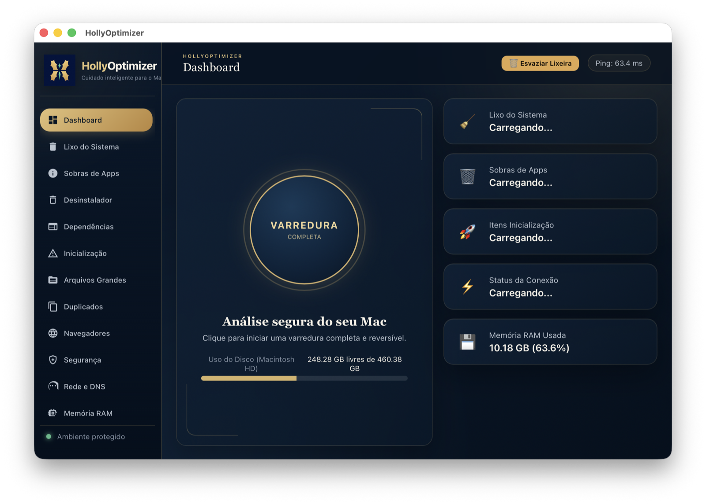
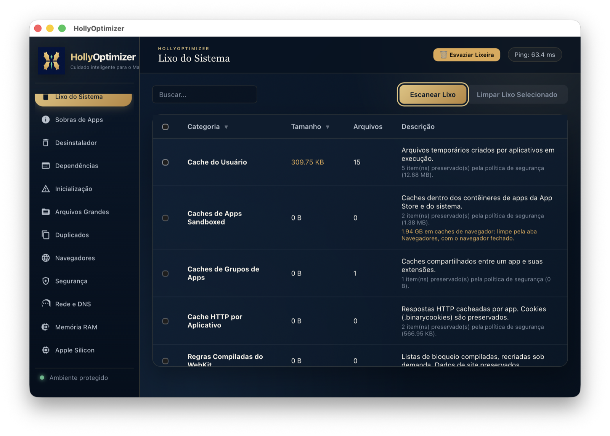
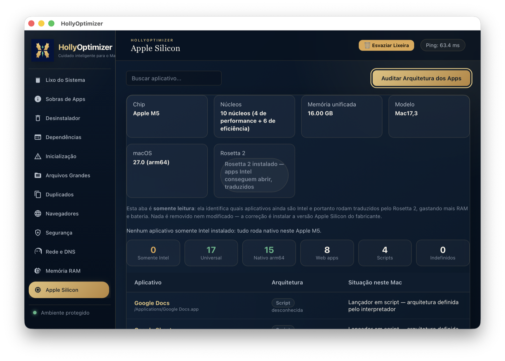
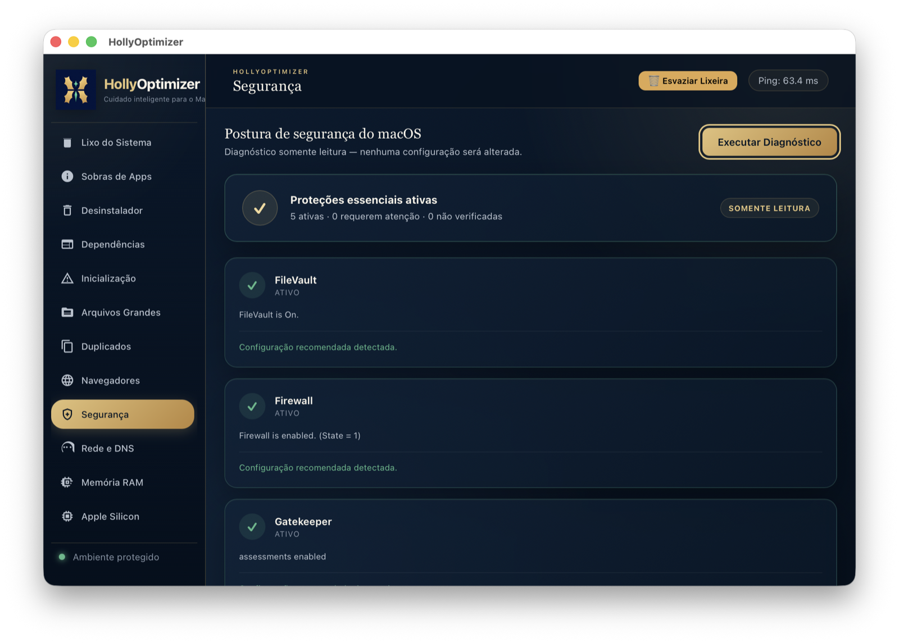

<p align="center">
  
</p>

<p align="center">
  <strong>Diagnóstico e limpeza segura, transparente e reversível para macOS.</strong><br>
  Política conservadora · Apple Silicon · Recuperação pela Lixeira
</p>

<p align="center">
  <a href="https://github.com/HollyGM/HollyOptimizer/actions/workflows/ci.yml"></a>
  <a href="CHANGELOG.md"></a>
  
  
  
  <a href="LICENSE"></a>
</p>

> **Parte da suíte Holly**  
> Ferramentas local-first para texto, documentos e mídia, com privacidade por padrão e segurança verificável.  
> [HollyOCR](https://github.com/HollyGM/HollyOCR) · [HollyTranscrição](https://github.com/HollyGM/HollyTranscricao) · [HollyCorretor](https://github.com/HollyGM/HollyCorretor) · [Texto em Áudio](https://github.com/HollyGM/HollyTextoEmAudio) (voz online)



O **HollyOptimizer** é um utilitário desktop para diagnosticar o Mac, localizar desperdício de espaço e executar correções seguras. O projeto combina Python, PyWebView, HTML, CSS e JavaScript e foi otimizado para Apple Silicon, sem abandonar a compatibilidade de desenvolvimento com Macs Intel.

> A versão atual é **0.7.3 (build 19)**. O aplicativo foi validado em um MacBook com chip Apple M5. O código é específico do macOS; Windows e Linux poderão receber implementações próprias no futuro, mas ainda não são suportados.

## Recursos

- **Permissões guiadas:** ao abrir o app, o Acesso Total ao Disco é verificado passivamente. As autorizações de Automação (Finder, System Events) são verificadas quando a aba Permissões é aberta, evitando disparar AppleEvents sem contexto. Há um botão direto para o painel correto dos Ajustes do Sistema para cada item, e um aviso no Dashboard indica quando algo precisa de atenção.
- **Resumo por Apple Intelligence:** um modelo on-device (Foundation Models) reescreve o resumo da varredura em linguagem natural. Se o texto reescrito alterar, omitir ou inventar qualquer número, ele é descartado e o app volta ao resumo padrão. Totalmente opcional e local — nada sai do Mac. Requer Apple Silicon, macOS 26 ou posterior e Apple Intelligence ativado.
- **Limpeza reversível:** caches e arquivos temporários elegíveis são enviados à Lixeira nativa; ela nunca é esvaziada automaticamente. Inclui caches de desenvolvimento (NPM, Pip, Cargo, Gradle, Xcode DerivedData).
- **Política central de segurança:** Keychains, iCloud, Mail, Messages, SSH, bancos de dados, cookies e outras áreas sensíveis são bloqueados.
- **Sobras de aplicativos:** detecção conservadora, limitada a itens cujo aplicativo de origem pode ser verificado.
- **Desinstalador:** move o aplicativo para a Lixeira, pedindo autenticação do macOS apenas quando necessário, e localiza arquivos de suporte em `~/Library` pelo bundle identifier e pelo nome registrados na última listagem de aplicativos.
- **Navegadores:** limpeza dedicada de caches de Safari, Firefox, Zen, Orion e navegadores Chromium (Chrome, Edge, Brave, Vivaldi, Arc, Opera e outros), preservando histórico, senhas, cookies, sessões, favoritos e extensões.
- **Inicialização:** inventário e gerenciamento de LaunchAgents, LaunchDaemons e itens de início de sessão.
- **Arquivos grandes e duplicados:** busca configurável, ordenação por tamanho ou dias de inatividade, confirmação antes da remoção e revalidação por SHA-256.
- **Dependências:** auditoria de Homebrew, NPM e Pip, com remoção de pacotes da listagem mais recente e manutenção opcional do Homebrew.
- **Segurança:** diagnóstico somente leitura de FileVault, Firewall, Gatekeeper, SIP e atualizações.
- **Rede e memória:** teste de latência, limpeza do cache de DNS, pressão de memória, swap e encerramento confirmado de processos, sem usar `purge`.
- **Apple Silicon:** identifica chip, núcleos, memória unificada, Rosetta 2 e a arquitetura dos aplicativos instalados.

## Capturas de tela

| Lixo do Sistema | Apple Silicon |
|---|---|
|  |  |

| Dashboard | Segurança |
|---|---|
|  |  |

## Modelo de segurança

O HollyOptimizer adota privilégio mínimo e separa claramente inventário, revisão manual e limpeza automática.

- Dados comuns do usuário são processados sem elevação de privilégios.
- Itens removíveis são movidos para a Lixeira pela API nativa do macOS.
- Na limpeza de caches, todo o conteúdo de cada item é validado durante a varredura e revalidado imediatamente antes da movimentação. Se aparecer um pacote de documento, um item de serviço de nuvem, um link simbólico, um item de outro proprietário ou um item substituído, a operação falha de forma segura e o item permanece no lugar.
- Caches de navegador só são limpos com o navegador fechado.
- Na remoção de duplicados, cada conjunto mantém sempre uma cópia preservada, e solicitações simultâneas são serializadas para que nunca removam cópias opostas.
- O desinstalador não confia no nome enviado pela interface: usa somente o bundle identifier e o nome registrados pela última listagem de aplicativos.
- A interface escapa nomes de arquivos e de aplicativos, e uma Content Security Policy bloqueia scripts e manipuladores de evento inline, além de conexões de rede a partir do WebView.
- Snapshots locais do Time Machine, Docker Data, Xcode Archives, Xcode DeviceSupport, simuladores, backups de iPhone/iPad e caminhos do sistema são apenas medidos e informados.
- Itens recusados pela política são contabilizados e explicados na interface.
- A auditoria Apple Silicon é somente leitura e nunca altera ou “afina” binários universais.
- Esvaziar a Lixeira usa a Automação do Finder, autorizada explicitamente. Se ela for negada, o app oferece apenas a exclusão permanente local de `~/.Trash`, com uma segunda confirmação dedicada; Lixeiras de outros volumes não são tocadas.
- Acesso Total ao Disco é opcional; sem ele, o aplicativo continua funcionando e informa os locais inacessíveis.

Leia [SECURITY.md](SECURITY.md) antes de relatar uma possível vulnerabilidade.

## Requisitos

- macOS 12 ou posterior para o código-fonte; o aplicativo compilado pode exigir uma versão mais recente, calculada no build (o build 19 gerado localmente exige macOS 27 ou posterior — veja [Gerar o aplicativo](#gerar-o-aplicativo));
- Python 3.12 ou posterior para desenvolvimento;
- dependências fixadas em [`requirements.txt`](requirements.txt);
- Node.js para validar e testar a interface (o CI usa a versão 22);
- opcional, para o resumo por Apple Intelligence: Mac com Apple Silicon, macOS 26 ou posterior, Apple Intelligence ativado e `swiftc` (Xcode ou Command Line Tools) para compilar o auxiliar.

## Executar a partir do código

```bash
git clone https://github.com/HollyGM/HollyOptimizer.git
cd HollyOptimizer
python3.12 -m venv .venv
.venv/bin/python3 -m pip install --upgrade pip
.venv/bin/python3 -m pip install -r requirements.txt
.venv/bin/python3 hollyoptimizer_gui.py
```

A versão alternativa de terminal pode ser iniciada com:

```bash
.venv/bin/python3 hollyoptimizer.py
```

Ao executar a partir do código, o resumo por Apple Intelligence só fica disponível depois que o auxiliar Swift é compilado (o `build.sh` faz isso automaticamente). Sem ele, o app usa o resumo padrão:

```bash
swiftc -O tools/ai_summary/main.swift -o tools/ai_summary/hollyoptimizer-ai
```

## Testes

```bash
.venv/bin/python3 -m unittest discover -s tests -v
.venv/bin/python3 hollyoptimizer_gui.py --self-test
.venv/bin/python3 -m compileall -q core hollyoptimizer.py hollyoptimizer_gui.py
node --check gui/app.js
node --test tests/test_gui.js
```

A suíte Python cobre a política de segurança, o empacotamento e os menus do terminal; `tests/test_gui.js` cobre o progresso das varreduras e a ordenação de duplicados na interface. O autoteste apenas verifica recursos, comandos e políticas, sem limpar nada nem abrir a janela do aplicativo. O CI executa os mesmos passos em [`.github/workflows/ci.yml`](.github/workflows/ci.yml).

## Gerar o aplicativo

```bash
PYTHON_BIN=.venv/bin/python3 ./build.sh
```

O bundle será criado em `dist/HollyOptimizer.app`. Sem uma identidade Apple, o script produz um build de desenvolvimento com assinatura ad-hoc, adequado para uso local.

O script apaga `build/` e `dist/` antes de compilar, compila o auxiliar de Apple Intelligence quando há Apple Silicon e `swiftc`, executa o autoteste dentro do bundle e interrompe o build se a arquitetura gerada divergir do alvo pedido.

O código admite macOS 12 ou posterior, mas o macOS mínimo do aplicativo compilado também depende do Python e das bibliotecas nativas usados no build. O empacotamento calcula esse requisito, mostra o valor no log do PyInstaller e o registra em `LSMinimumSystemVersion`. O build local 19 exige macOS 27 ou posterior, devido ao Python embutido; para atender a versões anteriores do macOS, compile com um Python cujos binários tenham um alvo mínimo menor.

### Distribuição assinada e notarizada

Para distribuir o aplicativo a outros Macs, use uma identidade **Developer ID Application**, Hardened Runtime e um perfil do `notarytool`:

```bash
xcrun notarytool store-credentials hollyoptimizer-notary

HOLLYOPTIMIZER_RELEASE=1 \
PYTHON_BIN="/caminho/para/python3.12" \
CODESIGN_IDENTITY="Developer ID Application: Sua Empresa (TEAMID)" \
NOTARY_PROFILE="hollyoptimizer-notary" \
./build.sh
```

O alvo padrão é a arquitetura nativa do Mac usado na compilação. Solicite `universal2` (com `HOLLYOPTIMIZER_TARGET_ARCH=universal2`) apenas quando houver intenção real de distribuir também para Macs Intel e todas as dependências oferecerem `arm64` e `x86_64`.

## Estrutura

```text
HollyOptimizer/
├── core/                       # Backend e política de segurança
├── gui/                        # Interface HTML, CSS e JavaScript
├── tools/ai_summary/           # Auxiliar Swift opcional (Apple Intelligence on-device)
├── tools/macos_target.py       # Cálculo do macOS mínimo do bundle
├── tests/                      # Testes de segurança, empacotamento, terminal e interface
├── docs/branding/              # Banner e identidade visual
├── docs/screenshots/           # Imagens usadas na documentação
├── hollyoptimizer_gui.py       # Aplicativo desktop
├── hollyoptimizer.py           # Interface de linha de comando
├── HollyOptimizer.spec         # Configuração do PyInstaller
└── build.sh                    # Build, assinatura e notarização
```

## Colaboração

Contribuições são bem-vindas. Consulte [CONTRIBUTING.md](CONTRIBUTING.md), abra uma issue com o modelo apropriado e envie as alterações por pull request. Mudanças que removem arquivos precisam manter as garantias de confirmação, validação de caminho e recuperação pela Lixeira.

As mudanças de cada versão estão em [CHANGELOG.md](CHANGELOG.md).

## Licença

Copyright 2026 Thiago Albuquerque.

Distribuído sob a [Apache License 2.0](LICENSE). Consulte também o arquivo [NOTICE](NOTICE).
